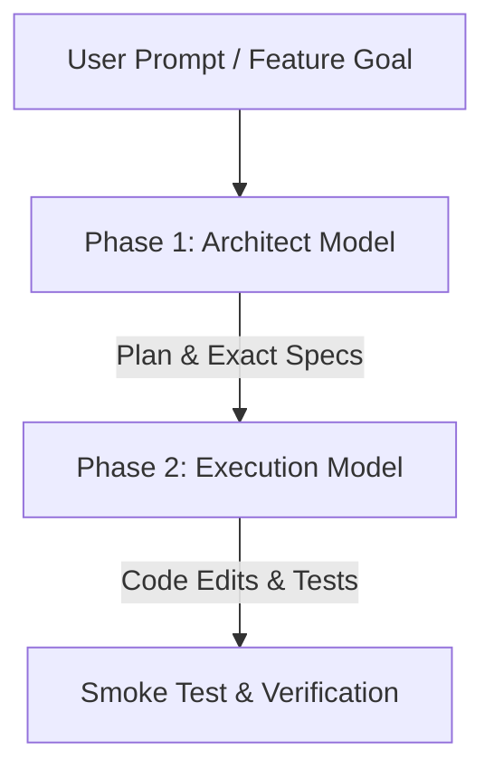

# Dual-Model Architect Mode

A token-efficient design pattern inspired by Aider and Factory Droid, optimizing token economy without sacrificing architectural precision.

## 1. Core Principle

- **Phase 1: Architect (Thinking / Reasoning)**
  - Model: High-reasoning (Claude Opus, OpenAI o1/GPT-6 Sol).
  - Purpose: Deep codebase analysis, dependency tracing, blast-radius mapping, and writing dense implementation specs.
  - Generates: Exact file paths, line ranges, function signatures, and failure modes.

- **Phase 2: Executor (Fast / Inexpensive Coder)**
  - Model: High-speed, low-cost (Gemini 3.8 Flash, Claude Sonnet 4.6).
  - Purpose: Mechanical implementation, file editing, formatting, and running tests.
  - Advantage: Eliminates paying premium Opus rates for mechanical code generation.

## 2. When to Use Architect Mode

- Multi-file feature additions (>3 files).
- Complex refactors where regression risk is high.
- Long-running sessions where context size exceeds 100k tokens.

## 3. Execution Commands in Katalyst

1. **Step 1 (Architect)**: Select `Claude Opus` or `GPT-6 Sol`. Instruct:
   `"Create an implementation plan for <feature>. Do not write production code yet."`
2. **Step 2 (Review)**: Review the resulting `.plan.md` in Katalyst's `PlanReviewView`.
3. **Step 3 (Switch to Executor)**: Switch model to `Gemini 3.8 Flash` or `Claude Sonnet`.
4. **Step 4 (Build)**: Click **[ Build Locally ]** or approve in chat to implement the plan at fraction of the token cost.
