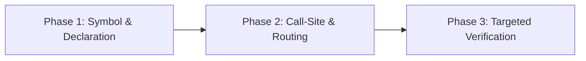

# Deep Search (Multi-Phase Codebase & Architectural Discovery)

A structured, token-efficient methodology for deep codebase search without reading file-after-file sequentially.

## 1. Search Phasing (Triangulation Strategy)

Always proceed in three disciplined stages rather than opening whole files:



1. **Phase 1: Symbol & Declaration Discovery**
   - Search for type definitions, interfaces, data classes, or protocols first:
     ```bash
     katalyst-search --symbol "UserSession"
     # or targeted grep for declaration patterns:
     grep -E "(class|interface|type|struct|enum)\s+UserSession"
     ```
   - Goal: find the authoritative contract and location before tracing usages.

2. **Phase 2: Routing, Registration & Callsite Mapping**
   - Locate where the symbol is injected, routed, or invoked:
     ```bash
     katalyst-search "UserSession" --ext "dart,kt,ts,go"
     ```
   - Filter out test mocks or fixtures if investigating production paths.

3. **Phase 3: Targeted Line-Bounded Reading**
   - Once relevant files are pinpointed, use line ranges (`read path/to/file.ext:40-90`).
   - NEVER read entire files larger than 100 lines when exploring.

## 2. CLI Deep Search via `katalyst-search`

Katalyst includes `katalyst-search` in `~/.local/bin/` to combine fast lexical searching with AST symbol awareness and automatic noise pruning:

- **Search by keyword**:
  ```bash
  katalyst-search "push_notification_service"
  ```
- **Filter by file extensions**:
  ```bash
  katalyst-search "MethodChannel" --ext "dart,kt,swift"
  ```
- **Filter for symbol definitions only**:
  ```bash
  katalyst-search --symbol "AuthRepository"
  ```
- **Search specific directory scope**:
  ```bash
  katalyst-search "payment_gateway" ./feature/billing/
  ```

## 3. Semantic Search via `omp find`

When the exact keyword is unknown or searching for behavior described in natural language:

```bash
omp find "where are user notification click redirects handled" ./lib/
```

- Uses fast lexical pre-filtering + passage ranking.
- Returns candidate files and specific line windows with scoring confidence.

## 4. Default Exclusion Guards

Always exclude noise that pollutes token budgets and search results:
- Package managers: `node_modules/`, `Pods/`, `.dart_tool/`, `.gradle/`
- Build output: `build/`, `dist/`, `target/`, `DerivedData/`, `.next/`
- Cache & logs: `*.log`, `*.lock`, `coverage/`, `.cache/`
